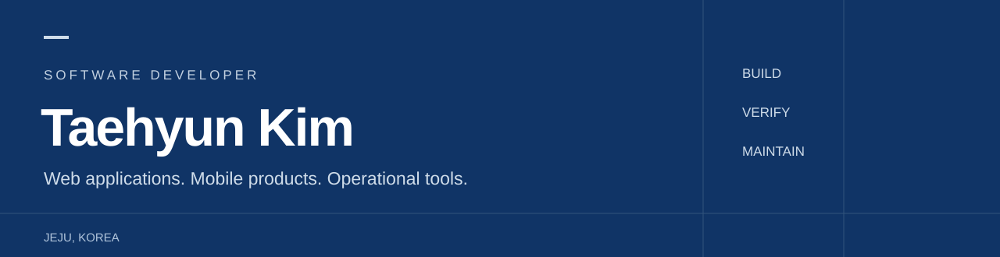

웹·모바일 서비스를 개발하고, 실제 운영에서 생기는 문제를 개선합니다.  
인바디 iOS·ERP, AI 폐전선 수거 자판기 웹 시스템, 카지노 IT 운영과 사내 업무 시스템 개발을 경험했습니다.

**[프로젝트 포트폴리오 →](https://github.com/kimth1113/portfolio)** · [개발 기록](https://velog.io/@kimth1113)

### Selected work

| 프로젝트 | 개발 내용 |
| :--- | :--- |
| [BGNT IT 요청·이슈 통합 관리 시스템](https://github.com/kimth1113/portfolio/blob/main/projects/bgnt.md) | 요청 접수, 문서 연결, 이슈 추적, 보고서 자동화 |
| [내폰네컷](https://github.com/kimth1113/portfolio/blob/main/projects/apps.md#내폰네컷) | 모바일·토스 사진 편집 앱 개발·운영 |
| [AI 증명사진](https://github.com/kimth1113/portfolio/blob/main/projects/apps.md#ai-증명사진) | 모바일·토스 사진 생성·편집 앱 개발·운영 |
| [메아리AI · 치매타파 · AI야 이게 뭐게](https://github.com/kimth1113/portfolio/blob/main/projects/apps.md) | 음성·인지 게임·드로잉 퀴즈 서비스 |
| [인바디 · 르호봇알브이엠](https://github.com/kimth1113/portfolio/blob/main/projects/experience.md) | Swift iOS, ERP, AI 폐전선 수거 자판기 웹 개발 |
| [LIFELOG](https://github.com/kimth1113/LIFELOG) · [ScreenCoach](https://github.com/kimth1113/portfolio/blob/main/projects/screencoach.md) | AI 포토부스 · 화면 OCR 코칭 프로토타입 |

### Development

**Web** React · JavaScript · TypeScript  
**Mobile** Swift · React Native · Expo  
**Server** Python · Django · Node.js · ASP.NET  
**Data & tools** SQLite · SQL · Git · ChatGPT/Codex

### Education

**삼성전자 주관 삼성 청년 SW 아카데미(SSAFY)** · 2021.01–10  
Python·JavaScript 웹 개발 교육 1,300시간 · 우수 교육생 조기 수료
